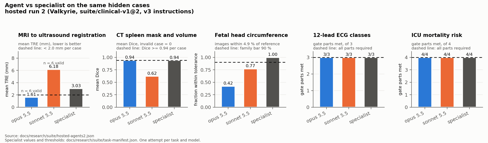
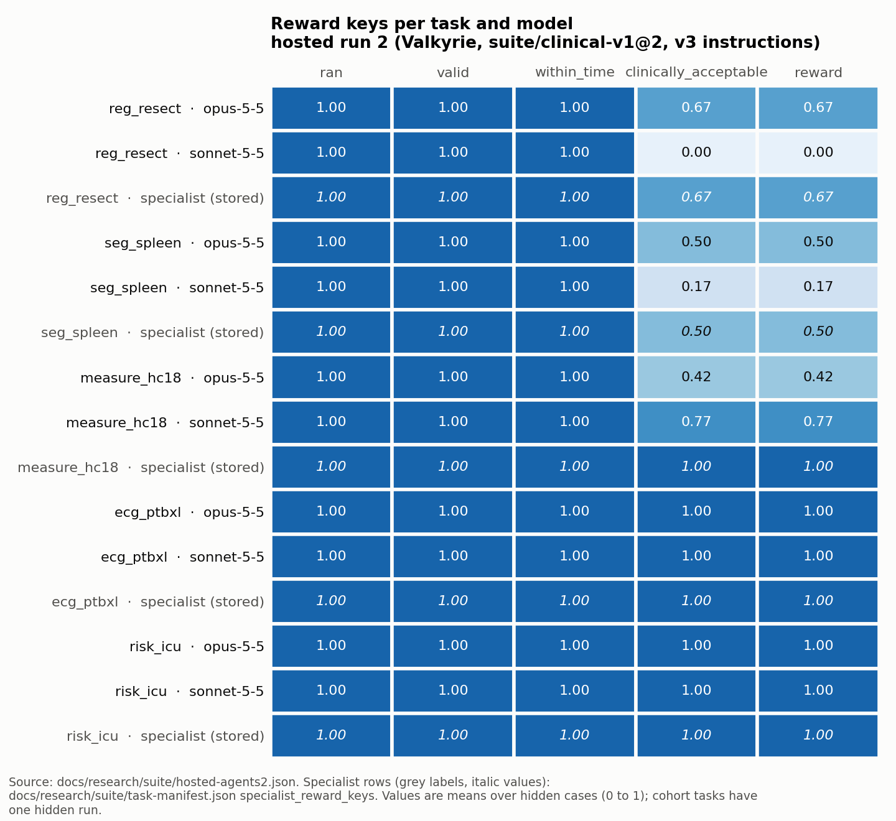
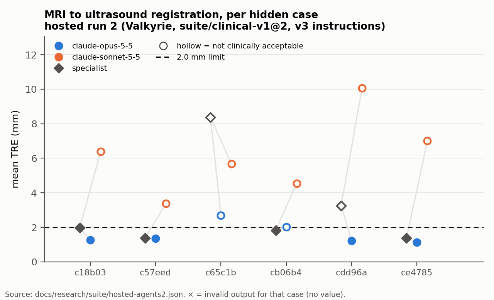
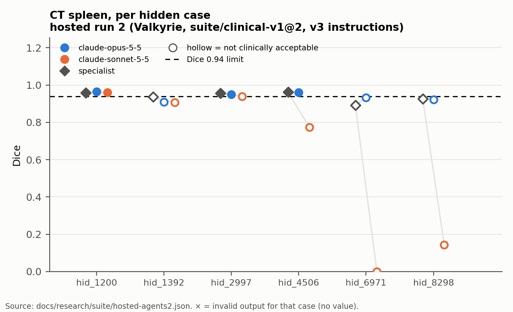
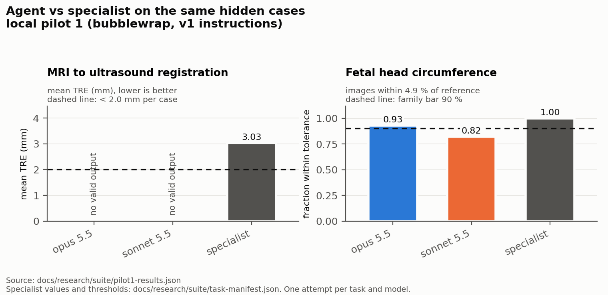
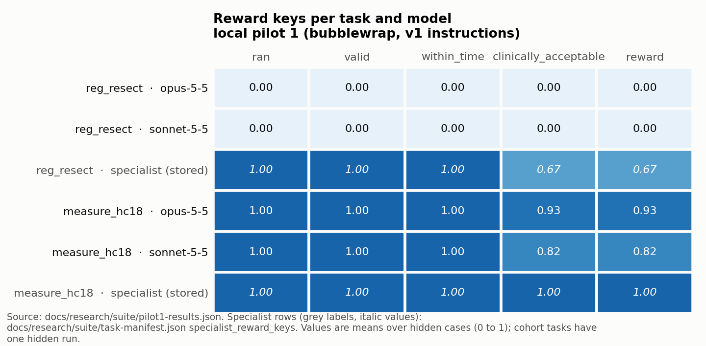
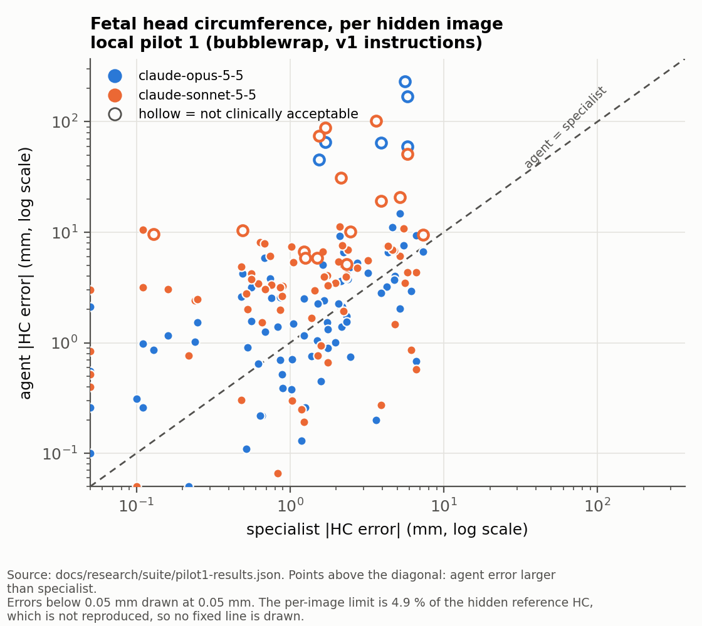

# Clinical deliverables: coding agents against specialist systems on real medical data

<!-- HUMAN-WRITTEN OVERVIEW: Jin writes this paragraph. Do not generate or edit. -->
> _Overview paragraph to be written by Jin._

Submission to the Vals AI hackathon track "Build Your Own Eval" (14 to 15 November 2026), run on
Valkyrie in the organisation `hackathon-neuronetwork-b91c517178`. The exact track text is in
[docs/research/hackathon-prompt.md](docs/research/hackathon-prompt.md).

## How the benchmark works

### What it tests

A frontier coding agent (Claude Code, with no web access) is given real public medical data and
must deliver a clinical artifact: a registration of pre-operative magnetic resonance imaging (MRI)
to intra-operative ultrasound, a computed tomography (CT) organ mask with its volume in millilitres,
a fetal head circumference (HC) in millimetres, or calibrated probabilities for electrocardiogram
(ECG) classes or intensive care unit (ICU) mortality. A separate verifier runs the agent's pipeline
on hidden cases under a clinical time limit, scores the output with the metric a clinician or
challenge organiser would use, and compares it with a specialist system run on the same hidden
cases. The design is in [DESIGN.md](docs/research/suite/DESIGN.md) and the current plan in
[PLAN.md](docs/research/suite/PLAN.md).

### The task contract

- **Agent side.** The agent's workspace holds a README with the clinical task and output format,
  development cases with their references, and nothing from the hidden cases. The task image has a
  fixed Python environment (`/opt/benchmark-venv`) with standard scientific packages and, for some
  families, CPU-only PyTorch with no pretrained weights. The agent's network is limited to the
  model API (`api.anthropic.com`). The agent must leave a self-contained offline pipeline at
  `/workspace/output/pipeline/run.sh INPUT_DIR OUTPUT_DIR`.
- **Verifier side.** A separate verifier sandbox, with no network, runs that pipeline once per hidden
  case (or once on the whole hidden cohort for cohort tasks) as an unprivileged user, under a
  wall-clock limit that the grader measures itself. It grades the outputs against hidden references
  and against the specialist's stored outputs for the same cases.
- **Session limit.** Each task has an agent session limit (30 to 60 minutes). Whatever is in
  `/workspace/output/pipeline/` when the session ends is graded as found. From task version 3
  ([instructions-v3.md](docs/research/suite/instructions-v3.md)) the instruction states this; earlier
  versions did not (see Results).

Every task writes `reward.json` with exactly seven keys, each in [0, 1]
([suite/README.md](suite/README.md)):

| Key | Meaning (per-case tasks: mean over hidden cases) |
|---|---|
| `ran` | the pipeline produced the required files |
| `valid` | the output passed the format, unit and geometry checks |
| `within_time` | the case finished inside the grader's time limit |
| `clinically_acceptable` | valid and meets the clinical threshold; for cohort tasks 1 only if every gate part is met |
| `quality` | the family's primary metric mapped to [0, 1], with 0 for an invalid case |
| `vs_specialist` | `min(1, quality / specialist quality)` |
| `reward` | `clinically_acceptable` if `ran`, `valid` and `within_time` are all 1, otherwise 0 |

Raw values in mm, mL and seconds are written to `metrics.json`. For cohort tasks the fraction of
gate parts met is reported as `gate_fraction` but earns no reward, so a constant predictor cannot
collect partial credit ([DESIGN.md](docs/research/suite/DESIGN.md)).

### Why these metrics

The choices follow the literature review in
[metrics-review.md](docs/research/suite/metrics-review.md); section numbers below refer to it.

- **Registration: target registration error (TRE) on expert landmarks, in mm.** TRE is the accepted
  accuracy measure for registration, and image similarity or whole-organ overlap can rate wrong
  transforms as good (section 1(b), Fitzpatrick and West 2001; Rohlfing 2012).
- **Segmentation: overlap plus volume in physical units.** The Dice similarity coefficient (Dice) is
  the default overlap metric and should be paired with a boundary metric; when the clinical use is a
  volume, report the volume error in mL (section 1(a), Metrics Reloaded; Bland and Altman). Our
  spleen task scores Dice and relative volume error and reports surface distance metrics without a
  threshold.
- **Measurement: absolute error in physical units against a declared tolerance** (section 3).
- **Probabilities: discrimination is not enough.** The area under the receiver operating
  characteristic curve (AUROC) measures ranking only; calibration and decision-curve net benefit
  decide whether a risk is usable, and most published prediction models never assessed calibration
  (sections 1(c) and 1(d); Van Calster et al.; Vickers and Elkin; Christodoulou et al. 2019).
- **Subgroups.** Averages hide harm, so the cohort tasks require a bound on the worst subgroup
  (section 1(e)).
- **Time is a gate.** An answer that arrives after the clinical window is of no use, so a late case
  fails; challenges such as FLARE and Learn2Reg already score runtime for algorithms (section 1(g)).
- **Small hidden sets.** Agent and specialist are compared on the same cases with a paired bootstrap
  and an interval, and no winner is declared when intervals overlap (section 1(h)).

### Task families

Counts, thresholds and specialist results are from
[task-manifest.json](docs/research/suite/task-manifest.json) and each family's document. "Our
convention" marks a bound we set before any agent result, without a published number behind it.

| Family | Data, licence, cases (development / hidden) | Deliverable | Clinical threshold and source | Time limit | Specialist on the hidden cases | Role |
|---|---|---|---|---|---|---|
| [`reg_resect`](docs/research/suite/reg_resect.md) | RESECT, CC BY 4.0; 4 / 6 patients | each MRI landmark's position in the ultrasound, RAS world mm | per case: mean TRE < 2.0 mm and below the initial error (Gerard et al. 2021, citing Prada et al.; AAPM TG-132 via Latifi et al. 2018) | 120 s per case | MIND-feature rigid registration: 4 of 6 cases pass; mean TRE 3.03 mm (initial 6.18 mm) | scored |
| [`seg_spleen`](docs/research/suite/seg_spleen.md) | Medical Segmentation Decathlon Task09, CC BY-SA 4.0; 8 / 6 CT scans | spleen mask (NIfTI) and volume in mL | per case: Dice ≥ 0.94 and relative volume error ≤ 10 % (Humpire-Mamani et al. 2020 inter-observer; the 10 % uses our normality assumption) | 300 s per case | TotalSegmentator 2.18.0 (not trained on these data): 3 of 6 pass; mean Dice 0.939 | scored |
| [`measure_hc18`](docs/research/suite/measure_hc18.md) | HC18, CC BY 4.0; 152 / 83 ultrasound images | head circumference in mm | per image: error ≤ 4.9 % of reference (Sarris et al. 2012 inter-observer limits, read from the abstract); family bar ≥ 90 % of images (our convention) | 10 s per image (manual measurement time, Han et al. 2024) | U-Net trained on a separate pool: 83 of 83 within tolerance; mean error 2.05 mm | scored |
| [`ecg_ptbxl`](docs/research/suite/ecg_ptbxl.md) | PTB-XL 1.0.3, CC BY 4.0; 8,000 / 1,000 ECGs | calibrated probabilities for five diagnostic superclasses | all of: myocardial infarction (MI) sensitivity ≥ 0.70 at specificity 0.90 (Willems et al. 1991); mean expected calibration error (ECE) ≤ 0.05 (our convention); macro AUROC gap to the worst sex or age group ≤ 0.05 (our convention) | 560 s for the cohort, killed at 1,120 s (our convention) | xresnet1d-style CNN: all 3 parts met; macro AUROC 0.921 | scored |
| [`risk_icu`](docs/research/suite/risk_icu.md) | PhysioNet/CinC Challenge 2012, ODC-By 1.0; 4,000 / 4,000 stays | calibrated in-hospital mortality risk | all of: challenge event-1 score ≥ 0.321 (SAPS-I on the same stays plus 0.05; margin is our convention; Silva et al. 2012); calibration slope 0.8 to 1.2 and calibration-in-the-large within 0.2 logit (our convention); net benefit at threshold 0.20 above treat-all and treat-none (Vickers and Elkin 2006); worst ICU-type or sex AUROC ≥ overall − 0.10 (our convention) | 300 s for the cohort | gradient-boosted trees: all 4 parts met; AUROC 0.873 | scored; [PLAN.md](docs/research/suite/PLAN.md) expects a control |
| [`triage_pharyngitis`](docs/research/suite/triage_pharyngitis.md) | PGUPharyngitis (Shojaei et al. 2025), CC BY 4.0; 561 / 180 patients | probability of bacterial sore throat from a throat photo and symptoms | four-part gate (operating point, calibration, net benefit, subgroup sensitivity) | 420 s for the cohort | no comparator passes (best: 2 of 4 parts; AUROC 0.674) | excluded: worked example of label and shortcut problems |

A synthetic toy task (`toy-sphere-volume-0001`) is used only as a platform smoke test and is not
scored.

### The gap rule

A frontier gap is claimed only against the specialist on the same hidden cases, never against the
threshold alone ([DESIGN.md](docs/research/suite/DESIGN.md)).

- **Per-case families** (registration, segmentation, measurement): take the hidden cases the
  specialist passes. An invalid or late agent case counts as a fail. Compute the paired difference
  in pass rate (agent minus specialist) with a bootstrap 95 % interval (2,000 resamples, seed
  20261114). A gap is shown when the agent fails at least one of these cases and the interval lies
  entirely below 0.
- **Cohort families** (ECG, ICU): a gap is shown when the specialist meets every gate part and the
  agent misses at least one. If both pass, the task is a control.
- **No comparator passes** (pharyngitis): the task is excluded from scoring.
- A run that fails because of our own infrastructure or instruction bug is reported as not
  interpretable, not as a gap.

Rules fixed before any agent run: one attempt per task and model, nothing rerun for a better
number; thresholds set from the literature or stated as our convention before any agent result;
splits and hidden-case hashes recorded per family ([PLAN.md](docs/research/suite/PLAN.md)).

## Results

**Status on 2026-11-15.** Hosted agent results on the current task version are pending. The results
that exist are a local pilot on two tasks and hosted checks of the reference solutions. Every number
below has one attempt per task and model, and hidden sets are small (6 cases for registration and
spleen). Read each section with its label.

### Hosted agent runs, task version 3 (headline)

<!-- RESULTS PLACEHOLDER (hosted-agents2): fill from docs/research/suite/hosted-agents2.json and
hosted-agents2.md once they exist. Table columns: task, model, reward, ran, valid, within_time,
clinically_acceptable, quality, vs_specialist, headline raw metric (agent / specialist), agents
passing / specialist-passed cases, paired difference with 95 % interval, verdict (gap shown, no gap,
control, not interpretable), agent wall time, cost. Then run
`~/miniconda3/envs/vals-suite/bin/python scripts/make_suite_figures.py` and uncomment:





-->
> **Placeholder.** Claude Code (no web) with Claude Opus 5.5 and Claude Sonnet 5.5 on the five
> scored tasks, dataset `suite/clinical-v1@2`. Table and figures to be added from
> `docs/research/suite/hosted-agents2.json`.

### Hosted agent runs, task version 2

<!-- RESULTS PLACEHOLDER (hosted-agents1): the operator's write-up (hosted-agents1.md) is not yet
written. hosted-agents1.json already holds 8 attempts (seg_spleen absent) and the figure script
already draws docs/figures/suite/hosted1_*.png from it. Under the prespecified analysis rule in
exp/suite-hosted-agents1/prespec.txt, a session timeout on reg_resect, seg_spleen, measure_hc18 or
risk_icu is "our bug / not interpretable", because version 2 did not state the session limit. -->
> **Placeholder.** Runs `0ae696de-4237-44bf-be49-25b90940772b` (Opus 5.5) and
> `1a4037a0-e1a9-4670-aee0-ceda221c6264` (Sonnet 5.5) on `suite/clinical-v1@1`, whose instructions
> did not state the session limit. Results to be added from
> [hosted-agents1.md](docs/research/suite/hosted-agents1.md) once written. These runs are not pooled
> with version 3 runs.

### Hosted checks of the reference solutions (final)

Before any agent run, each task's shipped reference solution (the "oracle") was run on Valkyrie to
check that the hosted image, artifact carry and separate verifier reproduce the locally measured
reward. The oracle is a reference pipeline, not the specialist: for registration and ICU risk it
is the specialist; for spleen and fetal head it is a classical method; for ECG it is a simple model
that misses the calibration bound.

Run `15fc4349-028e-42dc-982f-feccff226b7c` on `suite/clinical-v1@2`, from
[instructions-v3.md](docs/research/suite/instructions-v3.md):

| Task | reward | ran | valid | within_time | clinically_acceptable | quality | vs_specialist | expected reward | match |
|---|---|---|---|---|---|---|---|---|---|
| reg-resect-build-0001 | 0.6667 | 1 | 1 | 1 | 0.6667 | 0.3313 | 1.0 | 0.6667 | yes |
| seg-spleen-build-0001 | 0.0 | 1 | 1 | 1 | 0.0 | 0.4095 | 0.4362 | 0.0 | yes |
| measure-hc18-0001 | 0.7590 | 1 | 1 | 1 | 0.7590 | 0.4369 | 0.6092 | 0.759 | yes |
| ecg-ptbxl-superdiag-0001 | 0.0 | 1 | 1 | 1 | 0.0 | 0.9730 | 0.9903 | 0.0 | yes |
| risk-icu-mortality-0001 | 1.0 | 1 | 1 | 1 | 1.0 | 0.7451 | 0.9999 | 1.0 | yes |

All five rewards equal the expected values, and all seven keys equal the earlier oracle run
`8ca063d3-ff52-4bd0-883f-4fc815e6e31a` on version 2 ([hosted-oracle1.md](docs/research/suite/hosted-oracle1.md)).
That run also showed that the agent-phase network allowlist is enforced on Modal: pypi.org,
files.pythonhosted.org and example.com were unreachable and api.anthropic.com was reachable. DNS
for public names still resolved. Earlier, a synthetic smoke task gave reward 1.0 for both the oracle
and a Claude Sonnet 5.5 agent ([hosted-smoke.md](docs/research/suite/hosted-smoke.md)).

### Local pilot 1 (final, local only)

Claude Code 2.1.325 in a local bubblewrap sandbox with network access only to the model API, effort
high, 45-minute session, 5 USD cap, one attempt each, on the fetal head and registration tasks (task
version 1). This is not a hosted Valkyrie run: the local host had no CPU or memory caps and was
shared with other jobs. Source: [pilot1-results.md](docs/research/suite/pilot1-results.md) and
[pilot1-results.json](docs/research/suite/pilot1-results.json).

| Task | Model | reward | ran | valid | within_time | clinically_acceptable | quality | Headline raw metric | Specialist | Agent session |
|---|---|---|---|---|---|---|---|---|---|---|
| measure_hc18 | claude-opus-5-5 | 0.928 | 1 | 1 | 1 | 0.928 | 0.626 | mean error 10.08 mm (median 2.05) | 1.00 within; mean error 2.05 mm | 1,813 s, completed |
| measure_hc18 | claude-sonnet-5-5 | 0.819 | 1 | 1 | 1 | 0.819 | 0.424 | mean error 8.57 mm (median 4.08) | same | 2,701 s, timeout |
| reg_resect | claude-opus-5-5 | 0 | 0 | 0 | 0 | 0 | 0 | no output | 0.667; mean TRE 3.03 mm | 2,701 s, timeout |
| reg_resect | claude-sonnet-5-5 | 0 | 0 | 0 | 0 | 0 | 0 | no pipeline | same | 2,702 s, timeout |







Gap verdicts under the per-case rule (paired difference, agent minus specialist, on the cases the
specialist passes, 95 % bootstrap interval):

| Run | Specialist-passed cases | Agent passes | Pass-rate difference | Verdict |
|---|---|---|---|---|
| measure_hc18, Opus 5.5 | 83 | 77 | −0.072 (−0.133 to −0.024) | gap shown; the agent still clears the 90 % family bar (92.8 %) |
| measure_hc18, Sonnet 5.5 | 83 | 68 | −0.181 (−0.265 to −0.108) | gap shown; below the family bar (81.9 %) |
| reg_resect, Opus 5.5 | 4 | 0 | −1.0 (degenerate) | delivery failure at the deadline, not a measured accuracy gap |
| reg_resect, Sonnet 5.5 | 4 | 0 | −1.0 (degenerate) | delivery failure at the deadline, not a measured accuracy gap |

What this does and does not show:

- On fetal head circumference both agents fail images that the specialist U-Net passes. Opus 5.5
  has a lower median error than its mean suggests (2.05 mm, equal to the specialist's mean): its
  misses are gross detections of the wrong structure, not boundary error.
- The registration zeros are not evidence of a registration capability gap. The version 1
  instruction never stated the 45-minute session limit or that the pipeline is graded as found
  (pilot 1, "Our bugs" 1). The agents' own development-case errors were comparable to the
  specialist's (Opus 1.70 mm tuned in-sample on 4 cases, Sonnet 1.3 to 3.0 mm, specialist 1.85 mm).
  Version 3 fixes the instruction.
- **No gap is shown yet** for seg_spleen, ecg_ptbxl or risk_icu: no agent result on them is reported
  here.
- Pilot cost: 1.70 USD reported for the one run that completed; the upper bound for all four is
  16.70 USD.

### Run identifiers

| What | Valkyrie run | Dataset |
|---|---|---|
| Smoke oracle | `1ff5a572-99f5-4623-9062-397e992201ca` | `suite-scratch/toy-smoke@1` |
| Smoke agent (Sonnet 5.5) | `cea5e542-b160-4971-8119-0a9443d82663` | `suite-scratch/toy-smoke@1` |
| Oracle, version 2 | `8ca063d3-ff52-4bd0-883f-4fc815e6e31a` | `suite/clinical-v1@1` |
| Oracle, version 3 | `15fc4349-028e-42dc-982f-feccff226b7c` | `suite/clinical-v1@2` |
| Agents, version 2, Opus 5.5 | `0ae696de-4237-44bf-be49-25b90940772b` | `suite/clinical-v1@1` |
| Agents, version 2, Sonnet 5.5 | `1a4037a0-e1a9-4670-aee0-ceda221c6264` | `suite/clinical-v1@1` |
| Agents, version 3 | _placeholder_ | `suite/clinical-v1@2` |

Raw traces stay outside Git (`exp/` is ignored); the summaries above cite the files that hold them.

## What frontier agents get wrong

From the pilot 1 traces ([pilot1-results.md](docs/research/suite/pilot1-results.md), "Trace
analysis"). Each item is one observed run, not a rate.

1. **Shipping a pipeline that was never run.** Opus 5.5 on registration spent the session sweeping
   settings, wrote `run.sh` for the first time about 2.5 minutes before the session was stopped, and
   never executed it. The script ended `exec python3 -I "$HERE/main.py"`; `-I` removes the script's
   folder from the import path, so every hidden case failed in 0.2 s with
   `ModuleNotFoundError: No module named 'reg'`. The `main.py` it called still held the configuration
   from about minute 5, not the tuned one.
2. **An empty deliverable after 45 minutes of work.** Sonnet 5.5 on registration created the pipeline
   folder in its first minutes and never put a file in it. It ran three or four parallel experiments
   of 2 to 11 GB each, the host killed three of them for lack of memory, and it killed its own shell
   twice with `pkill -f`.
3. **Locking onto the wrong structure.** Opus 5.5 on fetal head circumference reached a median error
   of 2.05 mm, but six of 83 hidden images were gross mis-detections, with errors of −233, −170, +65,
   +60, +66 and +45 mm. Its own summary named the failure ("locks onto the wrong structure"); its
   pipeline has no check that rejects these.
4. **Leaving a working pipeline to chase a retrain.** Sonnet 5.5 on fetal head circumference shipped
   a working pipeline after about 17 minutes, then spent the remaining 28 minutes on an augmentation
   retrain that never finished, editing the shipped `feat.py` in place while doing so. It never
   mentioned the session limit. Its weakest group was the smallest heads (19 of 29 within tolerance,
   against 29 of 29 for the specialist).
5. **Optimistic self-validation.** Opus 5.5 estimated 95.4 % within tolerance from random-fold
   cross-validation over development images; the hidden result was 92.8 %. Images from the same
   examination could fall on both sides of its folds, which the opaque case IDs did not let it see.

Not counted as agent failures: the missing session-limit statement (our bug, fixed in version 3), and
the shared host's memory pressure during the pilot. To be extended with failure modes from the
hosted traces.

## How to run

All commands run from the repository root. Install nothing globally: every dependency goes into a
project conda environment or the project's Valkyrie virtual environment
([AGENTS.md](AGENTS.md)).

### Environment and tests

```bash
~/miniconda3/bin/conda env create -f suite/environment.yml        # creates "vals-suite"; pins in suite/requirements.txt
~/miniconda3/envs/vals-suite/bin/python -m pytest tests/suite -q    # 214 passed, 1 skipped on 2026-11-14
```

Each family also has its own environment for data preparation and comparators
(`suite/families/<family>/environment.yml`, environment name `vals-suite-<family>`).

### Data

Download each dataset from its source (table under "Data and licences") and stage it with the family's
own scripts; each family document lists the steps, checksums and split. Data live under
`/home/jkwei/data/vals-suite/<family>/` on the build machine and are not in Git.

### Exporting tasks

Each family has a `build_spec` in `suite/families/<family>/spec.py`, and
`suite.core.export.export_task` writes a Harbor-format task folder, refusing to write if any hidden
input, hidden reference or specialist output would reach the agent side. The pattern (shown for the
toy task in [suite/README.md](suite/README.md)) is:

```bash
~/miniconda3/envs/vals-suite/bin/python -c "from suite.families.toy.spec import build_spec; \
from suite.core.export import export_task; print(export_task(build_spec('/tmp/w'), 'dist/suite-toy'))"
.venv-valkyrie/bin/python scripts/validate_exports.py dist/suite-toy results/<date>-suite-toy-packaging
```

The `build_spec` signatures differ by family (see each `spec.py`). The version 3 export of the five
scored tasks went to `dist/suite-tasks-v3/<family>/<task-id>/`
([instructions-v3.md](docs/research/suite/instructions-v3.md)). Exported tasks are not in Git
(`dist/` is ignored); the published copy is the Valkyrie dataset `suite/clinical-v1@2`.

### Local pilot

Needs Linux with bubblewrap and an existing Claude Code login ([local-pilots.md](docs/research/suite/local-pilots.md)):

```bash
~/miniconda3/envs/vals-suite/bin/python scripts/run_suite_pilot.py run dist/suite-<family>/<task-id> \
  --run-name <run-name> --model claude-opus-5-5 --effort high --time-limit 2700 --budget 5
~/miniconda3/envs/vals-suite/bin/python scripts/run_suite_pilot.py summarize exp/suite-pilots/<run-name>
```

### Valkyrie

The CLI is pinned in `requirements-valkyrie.txt` (Python 3.12) and installed in `.venv-valkyrie/`.
Commands as used for this submission ([hosted-oracle1.md](docs/research/suite/hosted-oracle1.md),
[instructions-v3.md](docs/research/suite/instructions-v3.md), `exp/suite-hosted-agents1/prespec.txt`):

```bash
V=.venv-valkyrie/bin/valkyrie
$V org use hackathon-neuronetwork-b91c517178

# Publish the five scored tasks (version 3 became suite/clinical-v1@2, tag instr2)
$V dataset push suite/clinical-v1 dist/suite-tasks-v3 --tag instr2 --concurrency 2

# Check the reference solutions on Modal
$V run start --agent oracle --dataset suite/clinical-v1@2 --provider modal --concurrency 2 -l hosted-oracle-instr2

# Install the Claude Code agent without WebFetch and WebSearch (agents/claude_code_noweb)
$V agent push agents/claude_code_noweb

# One attempt per task and model
$V run start --agent claude_code_noweb-v1.0.0 --dataset suite/clinical-v1@2 \
  --model anthropic/claude-opus-5-5 --provider modal \
  -s ANTHROPIC_API_KEY anthropic-api-key --concurrency 3 -l <label>
```

The no-web agent is the registry `claude_code-v1.0.0` bundle with WebFetch and WebSearch removed,
Claude Code pinned to 2.1.325 and a per-task cap of `--max-budget-usd 8`. We chose Claude Code
because it is one of the harnesses Valkyrie provides, it is the general coding agent people use for
this kind of analysis, and our local pilot runner already used it. We removed the web tools because
the stock bundle reaches them through the allowed model API host
([hosted-smoke.md](docs/research/suite/hosted-smoke.md), finding 2).

### Figures

```bash
~/miniconda3/envs/vals-suite/bin/python scripts/make_suite_figures.py
```

This reads `docs/research/suite/pilot1-results.json`, `hosted-agents1.json` and `hosted-agents2.json`
when present (a missing file is skipped), takes specialist numbers and thresholds from
`task-manifest.json`, and writes PNG and SVG files to `docs/figures/suite/`, one set per source.
Sources are never pooled in one panel.

## Data and licences

| Family | Source | Licence | Attribution |
|---|---|---|---|
| reg_resect | RESECT, NIRD archive, doi:10.11582/2017.00004 | CC BY 4.0 | Xiao Y, Fortin M, Unsgård G, Rivaz H, Reinertsen I. Med Phys 2017;44(7):3875–3882 |
| seg_spleen | Medical Segmentation Decathlon Task09 Spleen (Memorial Sloan Kettering Cancer Center) | CC BY-SA 4.0; derived task data stay CC BY-SA 4.0 | Simpson et al. 2019, arXiv:1902.09063; Antonelli et al. Nat Commun 2022;13:4128 |
| measure_hc18 | HC18, Zenodo 1327317 | CC BY 4.0 | van den Heuvel TLA, de Bruijn D, de Korte CL, van Ginneken B. PLoS ONE 2018;13(8):e0200412 |
| ecg_ptbxl | PTB-XL 1.0.3, PhysioNet, doi:10.13026/kfzx-aw45 | CC BY 4.0 | Wagner et al. Sci Data 2020;7:154; Goldberger et al. Circulation 2000;101(23) |
| risk_icu | PhysioNet/CinC Challenge 2012 v1.0.0 | ODC-By 1.0 | Silva I, Moody G, Scott DJ, Celi LA, Mark RG. Computing in Cardiology 2012;39:245–248; Goldberger et al. 2000 |
| triage_pharyngitis (excluded) | PGUPharyngitis, figshare doi:10.6084/m9.figshare.28163513.v1 | CC BY 4.0 | Shojaei N. et al. Sci Data 2025;12:1418 |

Each exported task carries its licence and attribution file next to the data, with a list of the
changes we made (for example, opaque case IDs, cleared header text fields, cropping for the spleen
CT). Every task's hidden cases and specialist outputs sit only on the verifier side.

**Why pharyngitis is excluded.** No comparator meets its clinical gate on the hidden patients. The
reference label is a physician panel's vote from a photo and the symptom list, with no culture or
rapid antigen test; the symptoms the agent sees also informed the label; the labels run against the
Centor and McIsaac items (a partial McIsaac score ranks hidden patients inversely, AUROC 0.41); and
the phone model stands in for the city, with bacterial shares of 44 % and 15 %. We keep it as a
worked example of label and shortcut problems. We also removed EXIF metadata from every image
because 216 of 741 released images carried GPS coordinates
([triage_pharyngitis.md](docs/research/suite/triage_pharyngitis.md)).

**No UCSF patient data** is on Valkyrie or in this repository. The UCSF lymphoma work stays on the
UCSF servers; Git holds only code, schemas and aggregate results ([AGENTS.md](AGENTS.md)).

## Limitations

- **One attempt per task and model**, so there is no estimate of run-to-run variation.
- **Small hidden sets.** Registration and spleen have 6 hidden cases each, and the specialist passes
  only 4 and 3 of them, so per-case intervals there are wide or degenerate.
- **The specialists are not perfect.** The registration and spleen specialists fail some hidden cases;
  a gap is judged only on cases they pass.
- **Several bounds are our convention** (marked in the families table). They were fixed before any
  agent result and not tuned afterwards.
- **Public data.** All datasets are public, so models may have seen them. No pilot trace showed
  recognition of a dataset beyond its name in the README, and no run used outside reference values.
- **Local versus hosted.** Pilot 1 ran locally without CPU or memory caps on a shared host; only the
  hosted runs reflect the declared task resources. Valkyrie does not report the CPU and memory
  actually granted.
- **Effort setting.** The local pilot set effort high; the hosted agent passes no effort flag, so the
  Claude Code default applies.
- **Task versions.** Version 1 and 2 instructions did not state the session limit; version 3 does.
  Results from different versions are reported separately.
- **Cost.** Valkyrie reports no Modal cost; API costs come from the agent traces at list prices.
- **Scope.** This is a sandboxed, pre-clinical benchmark. It does not show that any pipeline is safe
  for clinical use.

## Related work

The review in [landscape.md](docs/research/suite/landscape.md) found that agent-produced imaging
deliverables have prior work, so we do not claim to be first at that. ReX-MLE runs machine-learning
engineering scaffolds on medical imaging challenge data and ranks them against human leaderboards;
AutoMedBench scores agent segmentations without a specialist bar; HealthAgentBench runs Claude Code
and Codex on real CT and MRI but grades labels and answers. What this suite adds is the combination:
frontier coding-agent harnesses; artifacts beyond segmentation (a registration in mm, a measurement in
physical units, calibrated risks); clinical time limits as gates; and a specialist run on the same
hidden cases, so that the comparison is per case rather than against a leaderboard. Learn2Reg and FLARE
score TRE, runtime and memory, but for submitted algorithms, not agents.

## Related UCSF PCNSL work

Earlier work in this repository on primary central nervous system lymphoma (PCNSL) imaging and
genetics, synthetic research-repair tasks and their pilots is described in
[docs/research/pcnsl-overview.md](docs/research/pcnsl-overview.md), the previous README. That work is
separate from this submission, and its patient-level data stay on UCSF servers.
