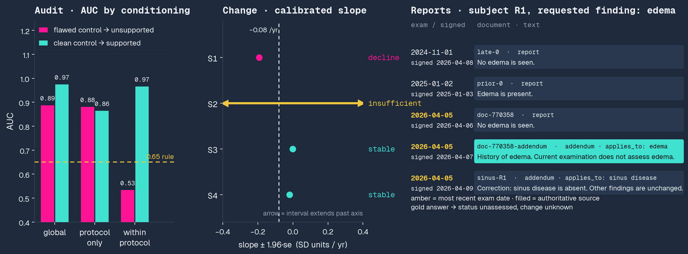
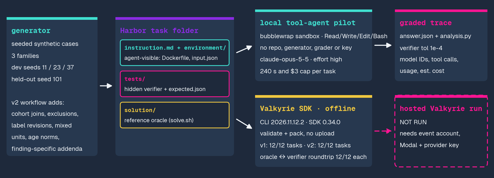
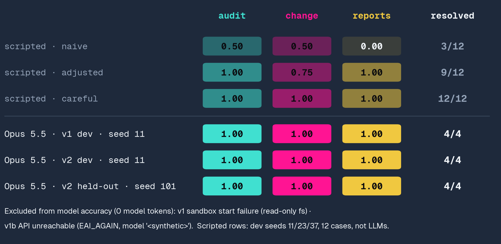
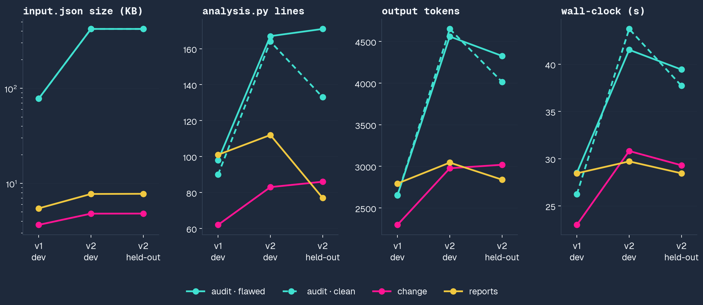
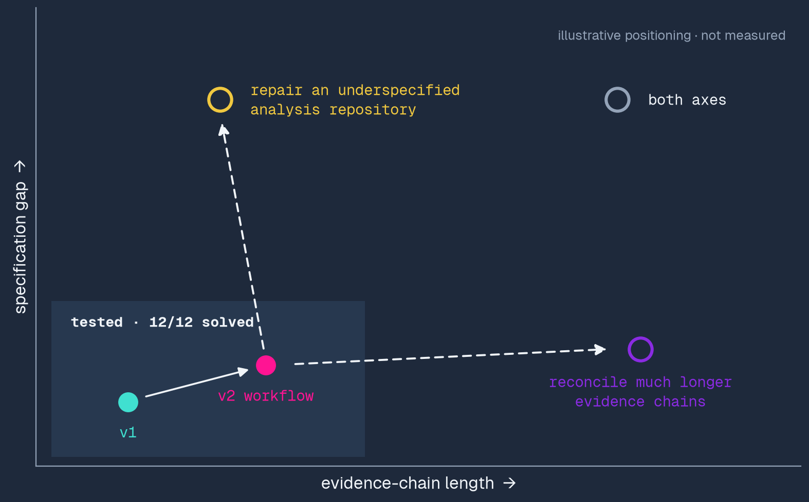

## Candidate task families — synthetic cases and their shortcuts

Vals "Build Your Own Eval" asks for a Valkyrie benchmark of tasks frontier models still get wrong; demos Nov 15 (vals.ai/hackathon). Three synthetic families, informed by failure patterns from Jin's research.

- **Audit:** incremental discrimination beyond acquisition protocol; flawed and clean controls
- **Change:** calibrated longitudinal slope with known measurement error and abstention
- **Reports:** exam-date chronology, finding-specific addenda, negation and uncertainty

---

## Harness — task export, local tool-agent pilot and Valkyrie readiness

- Official Valkyrie SDK validated and packed 12 task folders per variant; 12/12 oracle-verifier roundtrips per variant
- Hosted Valkyrie has not run

---

## Scores by iteration — Opus 5.5 and scripted controls

- claude-opus-5-5, effort high: 12/12 resolved across v1 dev, v2 dev and v2 held-out
- Scripted controls are not models

---

## Task burden and agent effort — v1 vs v2 workflow variant

- v2 audit input grew about 5x; agent output and wall-clock rose; score unchanged

---

## Evidence status — what these runs establish

- **Established:** local CLI tool-agent runs; actual model ID recorded; 12/12 resolved
- **Replay:** all 12 saved analysis.py re-run in fresh network-isolated workspaces, 12/12 reproduced; hosted grader remains artifact-only
- **Excluded:** 2 failed infrastructure runs (5 task attempts, 0 model tokens)
- **Not established:** hosted Valkyrie execution; unseen task families; multiple models

---

## Recommendation — next task design for a demonstrated gap

- Keep the harness; replace the tasks
- Next: repair an underspecified analysis repository, or reconcile much longer evidence chains, with defensible hidden tests
