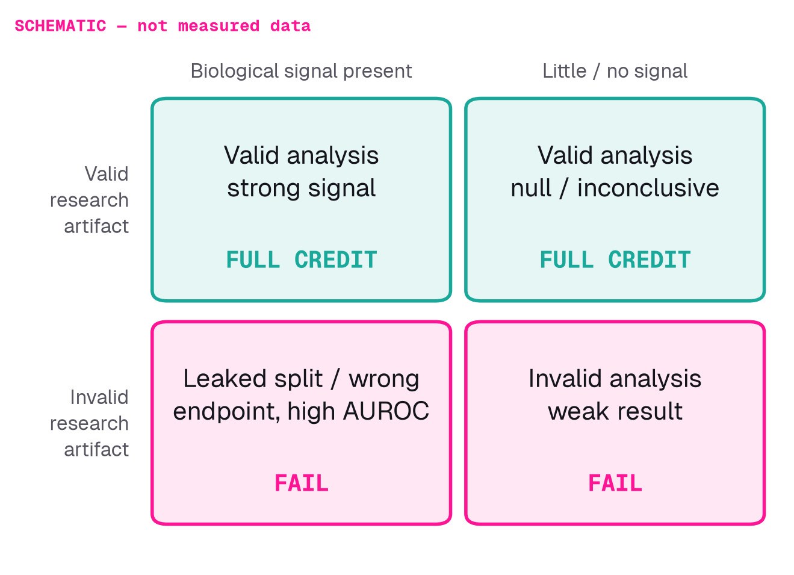
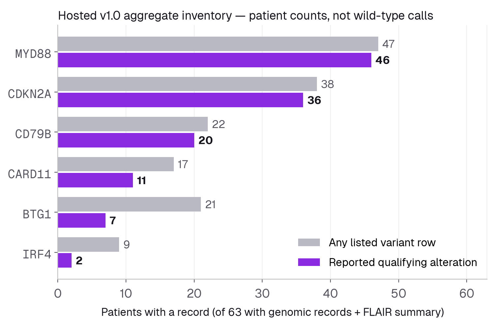
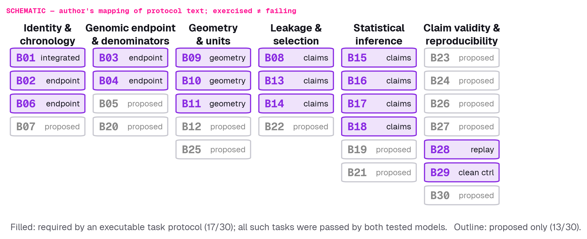
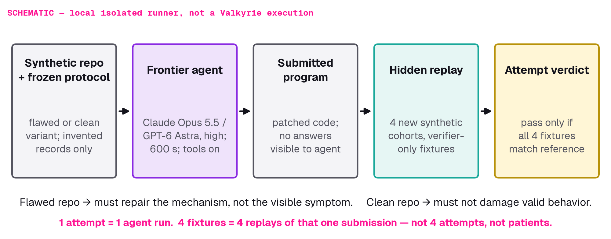
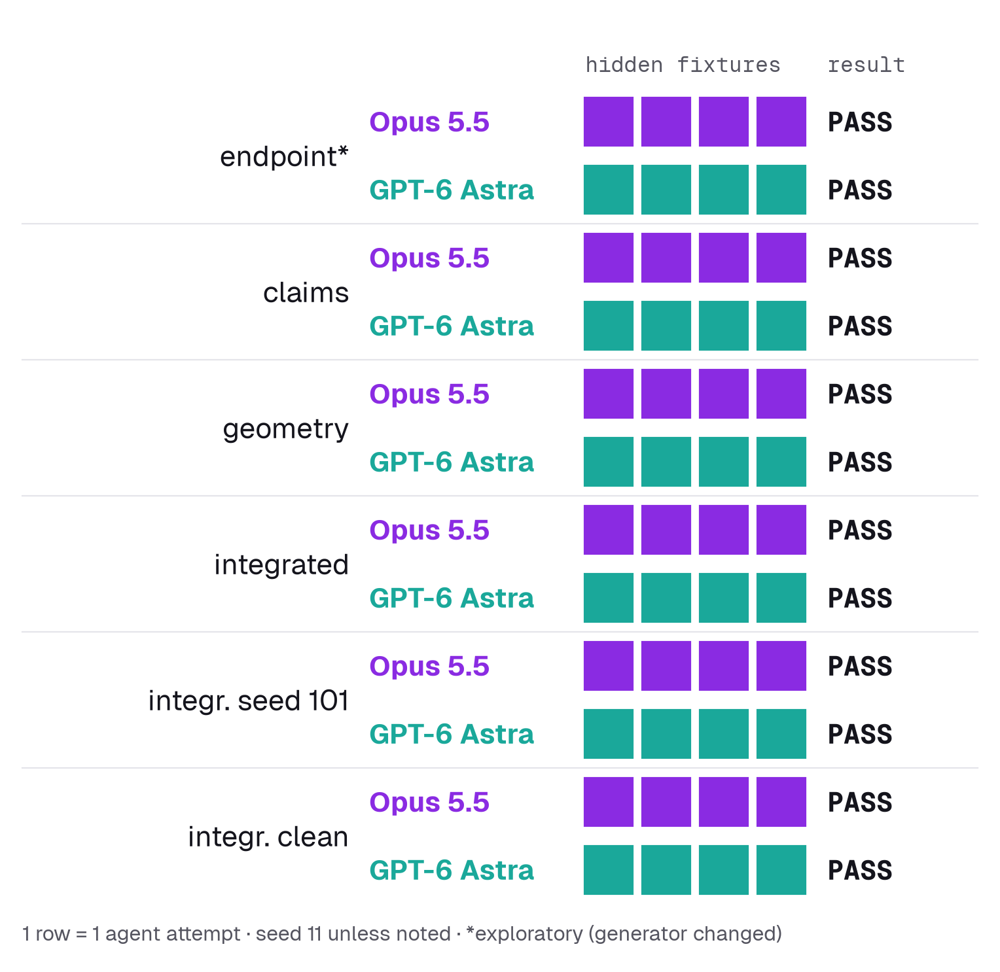
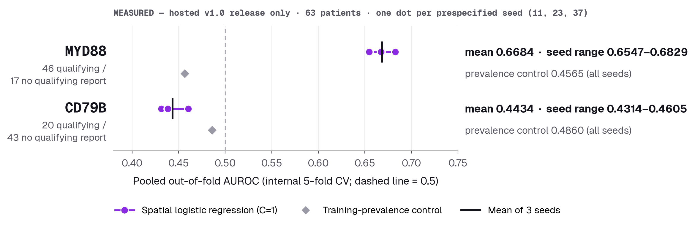
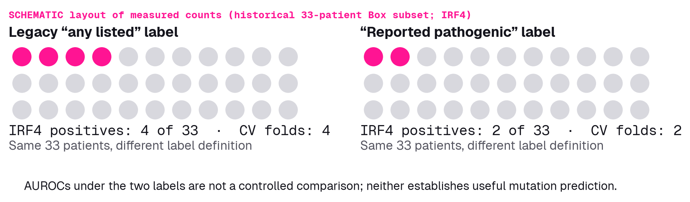

# Background and framing

---

## The ask: an eval on Valkyrie that frontier models still get wrong

### Requirement
Vals **Build Your Own Eval**: a benchmark **on Valkyrie** of a task frontier models still miss. Judged on demos; no public scoring weights.

### Our question
Do research agents produce **valid, reproducible claims** from a PCNSL imaging–genomic workflow?

### Status today
Tasks, controls and 16-archive package ready. **Both tested models passed all 12 attempts (10 frozen + 2 exploratory).** Hosted run pending access.

Source: vals.ai/hackathon. Honest headline: a prepared eval with working controls — no demonstrated frontier failure yet.

---

## What we score: valid research artifacts, not mutation predictability

Credit follows the validity of the analysis, not the size of the effect.

- **Why:** low biological predictability is not an agent failure. A correct null or inconclusive result earns full credit; a high AUROC from a leaked split or wrong endpoint earns none.

---

## Four data objects — provenance stays separate

| Object | What it is | What is verified | Used for |
|---|---|---|---|
| Hosted v1.0 archive | Controlled-access public release (DOI 10.58078/C2RP4V) | 16.66 GB received, CRC OK, SHA-256 pinned; aggregate inventory | Fixed 63-patient baseline; proposed task, not yet model-facing |
| Box candidate | Release-preparation copy | 5/5 metadata + 33/33 FLAIR summary files byte-identical to hosted | Historical 33-patient baselines only |
| Internal pipeline | Lab-derived features | 273/330 values differ from Box; cause unresolved | Matched control only |
| Synthetic counterfactual | Invented records and phantoms | Independent reference + hidden fixtures | All frontier pilots |

A private object is never relabeled public; matching files is not whole-release equivalence. Every frontier pilot used synthetic records only.

---

## Hosted v1.0 inventory: what the archive actually contains

Aggregate counts only. Record presence is not assay completeness, and "no record" is not wild type.

- **150:** patients, each with T1, CE-T1, FLAIR, ADC
- **64:** patients with genomic records
- **63:** with records and all ten FLAIR features finite
- **0:** DSC/CBV files detected

---

## Prior work exists — our contribution is narrow

| Prior work | Already covers | Gap we target |
|---|---|---|
| PCNSL MRI–genotype (Zhou 2026, n=92; LOC 2016, n=50) | MYD88/CD79B imaging association; same-cohort AUC 0.65–0.86 | Endpoint and validation choices as graded agent decisions |
| Related PCNSL radiomics (BCL6 rearrangement, Ki-67, PCNSL vs GBM) | Phenotype and diagnosis models | Agents must not substitute these for a named mutation |
| BLADE, ScienceAgentBench, DSBench | Scientific analysis decisions, executable outputs | Clinical imaging–genomic semantics |
| SciIntegrity-Bench, ReplicatorBench | Honest failure; replicable vs non-replicable claims | Matched clean controls with executable repair |
| PaperBench, PAPERBENCHX | Reproduction and evidence replay | Hidden new-cohort replay of a repair |

Not the first scientific-agent, integrity or replay benchmark. Contribution: PCNSL semantics + executable repair + matched controls on Valkyrie. Focused search, not systematic.

---

# Benchmark design

---

## Thirty candidate mechanisms — a catalog, not thirty failing tasks

Six families of consequential research mistakes. Filled tiles are required by an executable task protocol; none has produced a model failure.

---

## Three repair families plus one integrated audit

### Endpoint and cohort
First qualifying assay, final report revision, pre-therapy scan window; an unassayed gene is never negative.

### Statistical claims
Patient overlap in fit, transform or selection; freeze date; score direction; Holm across every planned hypothesis.

### Geometry and ADC
Affine and RAS/LPS frames, label-union volume, ADC scale, offset and units, out-of-grid samples.

### Integrated manuscript audit
Endpoint cohort, transitive identities, artifact ancestry, permutation nulls and Holm claims in one synthetic repository.

All four are synthetic counterfactual tasks with independent references: they test research behavior, not real PCNSL predictive accuracy.

---

## How an attempt is scored

Hidden new-cohort replay checks the repair; the clean twin checks for unnecessary damage.

---

# Results

---

## Pilot results: every attempt passed

The protocol supplies the rules: this measures faithful implementation and repair, not methodological discovery.

- **12/12:** attempts passed this round, both models (10 frozen + 2 exploratory)
- **10/10:** frozen submissions re-passed strict replay: 40 fixtures, 0 new model calls
- **12/12:** separate earlier Opus-only round; not pooled
- **0:** demonstrated frontier failures

---

## Both models passed every task

| Task | Claude Opus 5.5 | GPT-6 Astra |
|---|---|---|
| Endpoint (exploratory) | PASS 4/4 · 82 s | PASS 4/4 · 111 s |
| Claims (frozen) | PASS 4/4 · 70 s | PASS 4/4 · 131 s |
| Geometry (frozen) | PASS 4/4 · 75 s | PASS 4/4 · 115 s |
| Integrated, flawed | PASS 4/4 · 96 s | PASS 4/4 · 163 s |
| Integrated, held-out seed 101 | PASS 4/4 · 89 s | PASS 4/4 · 133 s |
| Integrated, clean twin | PASS 4/4 · 200 s | PASS 4/4 · 160 s |
| Response model ID | claude-opus-5-5 (confirmed) | not emitted (request-pinned) |

Effort high, 600 s budget, local isolated runner. One attempt per cell: wall time is descriptive, not a ranking. Endpoint generator changed mid-run, so it is not pooled.

---

## Hosted-release baseline: MYD88 0.67, CD79B 0.44

Mean pooled OOF AUROC, internal CV: 63 patients · 10 FLAIR spatial features · fixed C=1 logistic regression · train-fold-only imputation and scaling · 5-fold CV at 3 prespecified seeds.

- **Bounds:** seed range is not a confidence interval. Label is reported qualifying alteration vs no qualifying report, not biological wild type; IRF4 excluded (2 positives); scan–specimen timing not clinically adjudicated. No score flipping; no external-validation, clinical-utility or frontier-failure claim. Separate from the historical 33-patient baseline.

---

# Valkyrie readiness and limitations

---

## Execution evidence ladder

| Stage | Evidence | Status |
|---|---|---|
| SDK packaging | 16 archives: 4 families incl. integrated × 2 seeds × flawed/valid; 0 problems (CLI 2026.11.12.2, SDK 0.34.0) | Done; not execution |
| Local isolated pilots | 12/12 attempts passed (10 frozen + 2 exploratory); 40/40 frozen fixture replays | Done; not Valkyrie |
| Strict replay | 10/10 frozen submissions, 40 fixtures; 8 s CPU, 12 s wall, 512 MiB, 1 MB output; 0 model calls | Done; local only |
| Grader review and tests | Review fixes implemented; 60 local tests: 59 pass, 1 numerical skipped locally (passed in FAC 10/10) | Done; not execution |
| Root/container verifier path | Oracle isolation inside the task image | Untested; pending access |
| Valkyrie oracle smoke | Tracker run ID, verifier reward, logs | Pending access |
| Hosted frontier run | Run ID, trajectory, rewards, outputs | Pending access and credits |

No platform run ID, upload or submission exists yet. Launch checklist and read-only preflight are ready.

---

# Decision and next steps

---

## Next steps: readiness decision and next experiment

- **Decision:** keep the harness and passing controls. Do not pitch this version as a frontier-failure benchmark.
- **What works:** three repair families, integrated audit, clean twin and held-out seed; 12/12 attempts passed, 16 archives package cleanly.
- **Blocker:** hosted access and credits. Then oracle smoke first, then the integrated flawed, clean and held-out tasks.
- **Next experiment:** expert-adjudicated research decisions from genuine evidence, with a clear contract and less procedural scaffolding. Freeze as a new version.

Path forward: held-out results stay held out, never tuning data; stop at the predeclared cap if the new version also passes.

---

# Appendix

---

## Appendix A — PCNSL sources and standards

- **P01** Zhou 2026, Cancer Imaging — 92 PCNSL; ADC + DSC/CBV; MYD88/CD79B; AUC 0.652–0.861, same-cohort CV
- **P02** LOC network 2016, Neuro-Oncology abstract — 50 patients; no MYD88/CD79B location association
- **P03** Li 2025, Blood Cancer J — genomic subtype (BTG1/MYD88/IRF4); not an MRI predictor
- **P05 / P06** Liu 2024–25 — BCL6 rearrangement (random holdout); Ki-67 (external 55)
- **P08** Xia 2021, JMRI — PCNSL vs GBM diagnosis, cross-vendor test
- **Standards** IPCG MRI/PET, EHA–ESMO, AMP/ASCO/CAP, IBSI, CLAIM 2024, TRIPOD+AI, PROBAST+AI
- **Data** AWS registry ucsf-pcnsl; UCSF-PCNSL tutorial; DOI 10.58078/C2RP4V

---

## Appendix B — Agent-evaluation sources

- **Scientific analysis:** BLADE (2024), ScienceAgentBench (2025), DSBench, InfiAgent-DABench
- **ML research engineering:** MLAgentBench, MLGym, RE-Bench, MLE-bench
- **Reproduction and replay:** PaperBench (2025), PAPERBENCHX (2026 preprint), ReplicatorBench (2026)
- **Integrity:** SciIntegrity-Bench (2026 preprint); METR reward-hacking notes
- **Validity methods:** Kapoor & Narayanan (leakage), Cawley & Talbot (selection), Varoquaux (small-sample CV)
- **Search:** 4 broad queries, 49 raw records (not unique studies) plus primary-source follow-up; focused, not systematic

---

## Appendix C — Limitations and provenance

- **Sample:** one attempt per model per task-seed; fixtures are replays of one submission; templates are not patients
- **Endpoint pilot:** exploratory; generator changed during execution
- **Model identity:** GPT-6 Astra is request-pinned only; its CLI emitted no response model ID
- **Isolation:** local runner; root/container verifier path untested; 16-archive SDK packaging is not execution
- **Data:** hosted inventory is aggregate presence, not identity/privacy clearance or assay completeness
- **Hosted baseline:** descriptive internal CV; seed range is not a CI; specimen timing unadjudicated
- **Mechanism map:** author's grouping of protocol text; "exercised" does not mean "failing"
- **Evidence files:** listed in build-status.json with SHA-256 hashes

---

## Appendix D — Historical 33-patient baseline context

Changing the label definition changes the positives and the folds before any model is fit.

- **Lesson:** endpoint definition is a gradeable agent decision. The 33-patient retrospective subset supports no clinical-utility, generalization or frontier-failure claim.
