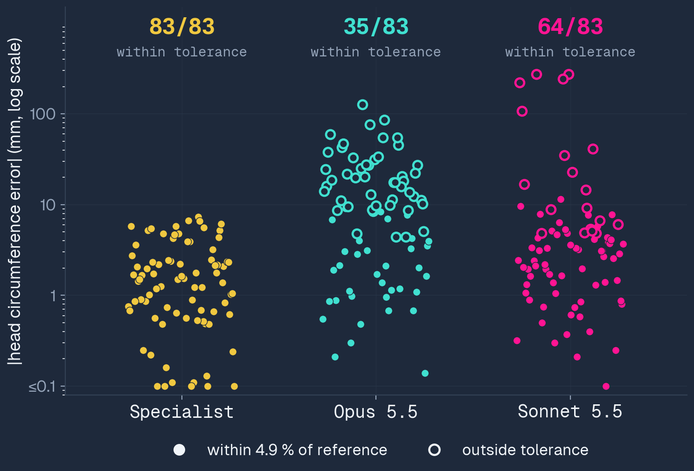
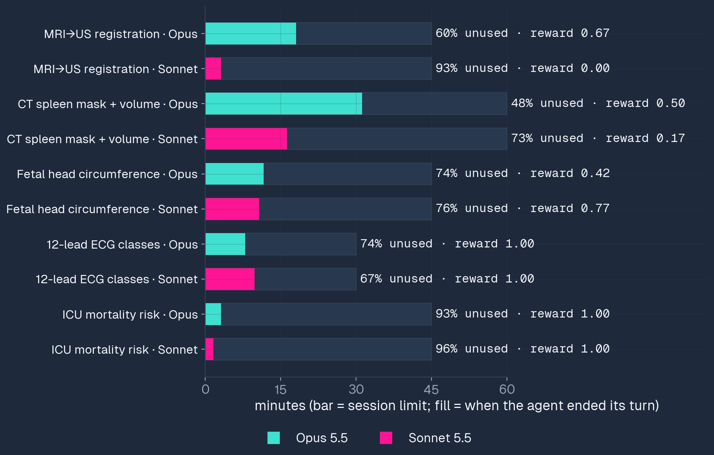
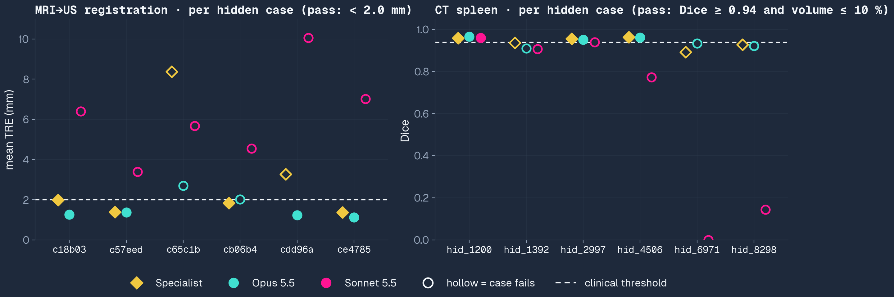

## Overview

Slot for the presenter's own overview, to be written and spoken by Jin.

---

## Clinical evaluation — what a generic benchmark score leaves out

- **Clinical metric in units:** registration error in mm, organ volume in mL, head circumference in mm, calibrated risk
- **Clinical time limit:** a pipeline that is accurate but late is not usable
- **Specialist baseline:** the bar is a specialist system on the same hidden cases, not a leaderboard

---

## Task contract and the five scored tasks

- Registration (RESECT), spleen mask and volume (MSD Task09), fetal head circumference (HC18), 12-lead ECG (PTB-XL), ICU mortality (PhysioNet 2012)

---

## Agent vs specialist — hosted run 2, same hidden cases

- Fetal head: gap shown for both models
- Opus 5.5 matches the specialist on registration and spleen
- ECG and ICU: controls

---

## Fetal head circumference — error per hidden image

- Specialist 83/83, Opus 5.5 35/83, Sonnet 5.5 64/83 within 4.9 %

---

## One trace — Opus 5.5 on fetal head stops at 11.6 of 45 minutes

- Cross-validation "about 60% … well below the 90% target"; hidden 42 %

---

## Session use — when each agent ended its turn

- 48 to 96 % of the session unused in all ten attempts

---

## Registration and spleen per case; ECG and ICU controls

- Opus 5.5 registration 4/6, mean TRE 1.61 mm vs specialist 4/6, 3.03 mm
- Opus 5.5 spleen 3/6, Dice 0.940 vs 0.939
- ECG and ICU: every gate part met by both models and the specialists

---

## Limits and how to run

- One attempt per task and model; 6 hidden cases for registration and spleen
- Claude Code default effort; raw values from local regrades
- Public datasets: contamination risk
- `valkyrie run start --agent claude_code_noweb-v1.0.0 --dataset suite/clinical-v1@instr2`

---

# Backup

---

## Gap verdicts — paired differences on specialist-passed cases

| Task · model | S | Agent passes | Pass diff (95 % CI) | Verdict |
|---|---|---|---|---|
| reg · Opus | 4 | 3 | −0.25 (−0.75 to 0.00) | no gap shown |

---

## Reward keys for every attempt — hosted run 2

| Task | Model | reward | quality | vs_specialist |
|---|---|---|---|---|
| reg_resect | Opus | 0.667 | 0.463 | 1.000 |

---

## Sonnet 5.5 on registration — a no-op pipeline after 3 minutes

- Shipped a copy of the input landmarks; mean TRE 6.18 mm, the uncorrected error

---

## Why the numbers can be trusted

- Hidden cases only on the verifier; oracle rewards reproduced on Valkyrie; network limited to the model API

---

## Earlier runs — the session-limit bug and its fix

- Hosted run 1 and local pilot 1 did not state the session limit

---

## Cost and run identifiers

- API $3.77 for hosted run 2; Modal cost not reported

---

## Clinical thresholds and their sources

- Registration, spleen, fetal head, ECG, ICU
