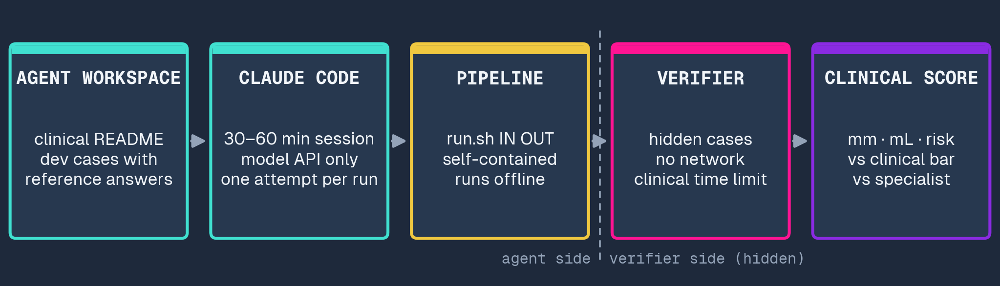
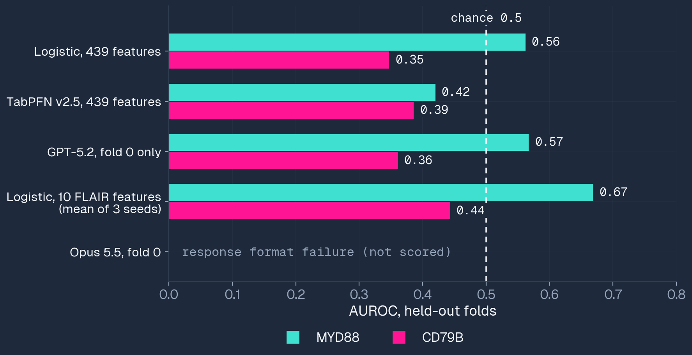

## Overview

Slot for the presenter's own overview, to be written and spoken by Jin.

---

## Clinical evaluation — what a generic benchmark score leaves out

- **Clinical metric in units:** registration error in mm, organ volume in mL, head circumference in mm, calibrated risk
- **Clinical time limit:** a pipeline that is accurate but late is not usable
- **Specialist baseline:** the bar is a specialist system on the same hidden cases, not a leaderboard

---

## Task contract and the seven task families

- Registration, spleen, fetal head, retinal vessels, ECG, ICU risk, treatment effect

---

## Agent vs specialist — three attempts per task and model

- Fetal head: gap shown in 3 of 3 attempts for both models

---

## Fetal head circumference — error per hidden image, six attempts

- Specialist 83/83; agents 35 to 74 of 83

---

## One trace — Opus 5.5 on fetal head stops at 11.6 of 45 minutes

- Cross-validation "about 60% … well below the 90% target"; hidden 42 %

---

## Stated time pressure — early endings and two instruction tests

- "I stopped there because of the session limit." at 8 of 45 minutes

---

## Retinal vessels — near-parity with the specialist

- Opus 5/8, Sonnet 4/8, specialist 6/8; no gap shown

---

## Limits and how to run

- Three attempts per task and model; 6 hidden cases for registration and spleen
- `valkyrie run start --agent claude_code_noweb-v1.0.0 --dataset suite/clinical-v1@instr2`

---

# Backup

---

## Gap verdicts — every attempt, specialist-passed cases

- Per-attempt verdicts

---

## Reward keys for every headline attempt

- All seven reward keys for the 30 headline attempts

---

## Session use — every attempt in every workstream

- No attempt used its whole session

---

## Sonnet 5.5 on registration — a no-op pipeline after 3 minutes

- Shipped a copy of the input landmarks; mean TRE 6.18 mm, the uncorrected error

---

## Why the numbers can be trusted

- Hidden cases only on the verifier; oracle rewards reproduced on Valkyrie; network limited to the model API

---

## Earlier runs — the session-limit bug and its fix

- Hosted run 1 and local pilot 1 did not state the session limit

---

## Report labelling — excluded from scoring, worked example

- Opus 5.5 beat the specialist but missed the F1 bar by 0.01

---

## Treatment effect — a control family

- Specialist and all six agent attempts pass

---

## PCNSL mutation prediction — no method above chance

- No comparator succeeds, so no frontier gap can be shown

---

## Dataset selection — licence, clinical bar, specialist, size

- About 40 datasets screened

---

## Cost and run identifiers

- API cost by round; Modal cost not reported

---

## Clinical thresholds and their sources

- Every family's bar and its source
