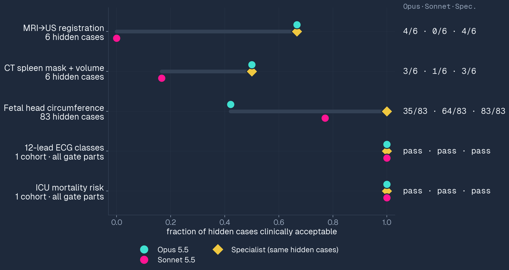
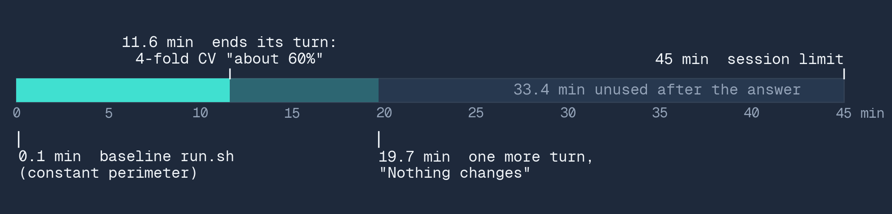
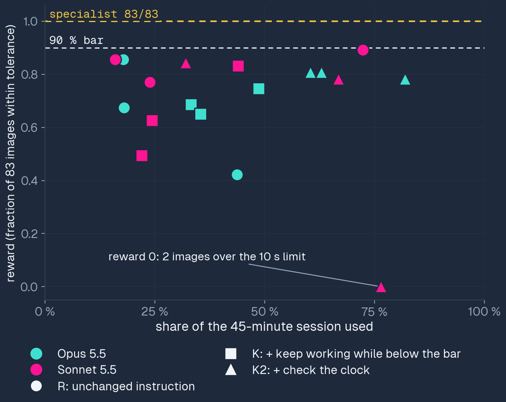
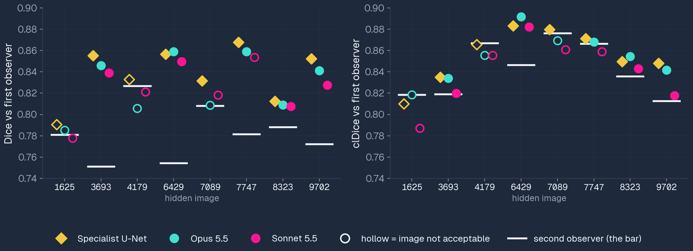
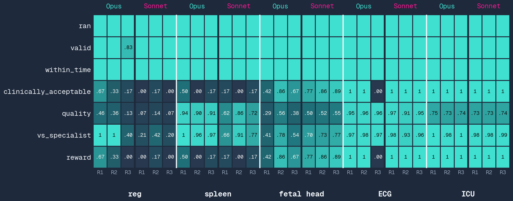
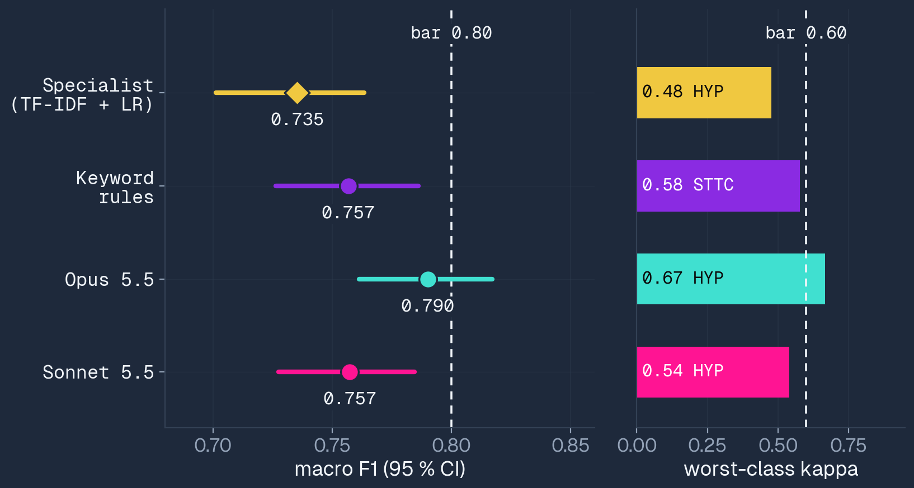
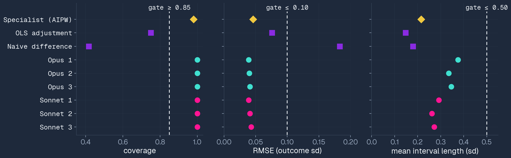
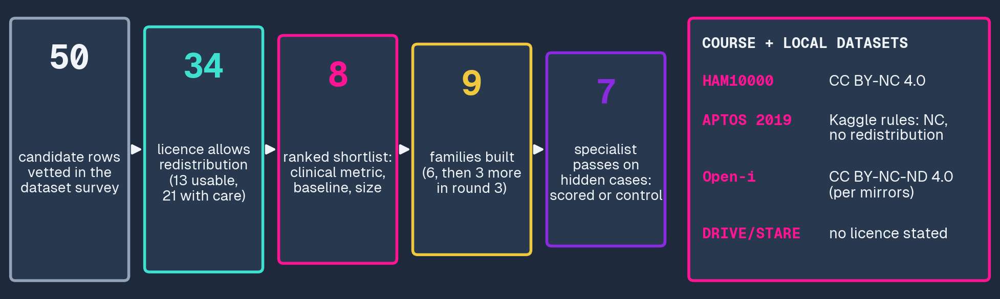

## Overview

<!-- Human-written by Jin, placed verbatim. Do not edit. -->
Best-known benchmarks for clinical AI, such as MedQA and MedAgentsBench, are multiple-choice questions where latest frontier models already score high, such as above 95% MedQA, and even Vals itself has archived this leaderboard as saturated. However, high benchmark scores don't translate to actual clinical benefit. Tasks like being able to measure a fetal head circumference to aid diagnosis, or lining up a preoperative MRI with an intraoperative surgical ultrasound to resolve anatomical movement, are deliverables that are practically useful for real patients. Additionally, time of operation, crucial for not breaking clinical workflows is an important constraint for real hospital settings that current medical benchmarks ignore. To solve this, we establish tasks that output clinically relevant units and operational time limits, and compare to baseline specialist software that hospitals would use in place of these frontier models. Tests are scored only against patient data never seen before. While some tasks, such as predicting ICU mortality, are accessible enough that all attempts match specialists, others such as measuring fetal head dimensions on ultrasound, show that frontier models lag far behind even compared to a pretrained U-Net. Several agents, when allowed 45 minutes, thought they ran out of time after only 8-15 minutes before meeting performance thresholds. Frontier model agents also tend to overestimate and submit working prototypes instead of "risking" time for improvements, with some describing next steps without following through.

---

## Clinical evaluation — what a generic benchmark score leaves out

- **Clinical metric in units:** registration error in mm, organ volume in mL, head circumference in mm, calibrated risk
- **Clinical time limit:** a pipeline that is accurate but late is not usable
- **Specialist baseline:** the bar is a specialist system on the same hidden cases, not a leaderboard

---

## Task contract and the seven task families

- Registration, spleen, fetal head, retinal vessels, ECG, ICU risk, treatment effect

---

## Agent vs specialist — three attempts per task and model

- Fetal head: gap shown in 3 of 3 attempts for both models

---

## Fetal head circumference — error per hidden image, six attempts

- Specialist 83/83; agents 35 to 74 of 83

---

## One trace — Opus 5.5 on fetal head stops at 11.6 of 45 minutes

- Cross-validation "about 60% … well below the 90% target"; hidden 42 %

---

## Stated time pressure — early endings and two instruction tests

- "I stopped there because of the session limit." at 8 of 45 minutes

---

## Retinal vessels — near-parity with the specialist

- Opus 5/8, Sonnet 4/8, specialist 6/8; no gap shown

---

## Limits and how to run

- Three attempts per task and model; 6 hidden cases for registration and spleen
- `valkyrie run start --agent claude_code_noweb-v1.0.0 --dataset suite/clinical-v1@instr2`

---

# Backup

---

## Gap verdicts — every attempt, specialist-passed cases

- Per-attempt verdicts

---

## Reward keys for every headline attempt

- All seven reward keys for the 30 headline attempts

---

## Session use — every attempt in every workstream

- No attempt used its whole session

---

## Sonnet 5.5 on registration — a no-op pipeline after 3 minutes

- Shipped a copy of the input landmarks; mean TRE 6.18 mm, the uncorrected error

---

## Why the numbers can be trusted

- Hidden cases only on the verifier; oracle rewards reproduced on Valkyrie; network limited to the model API

---

## Earlier runs — the session-limit bug and its fix

- Hosted run 1 and local pilot 1 did not state the session limit

---

## Report labelling — excluded from scoring, worked example

- Opus 5.5 beat the specialist but missed the F1 bar by 0.01

---

## Treatment effect — a control family

- Specialist and all six agent attempts pass

---

## PCNSL mutation prediction — no method above chance

- No comparator succeeds, so no frontier gap can be shown

---

## Dataset selection — licence, clinical bar, specialist, size

- About 40 datasets screened

---

## Cost and run identifiers

- API cost by round; Modal cost not reported

---

## Clinical thresholds and their sources

- Every family's bar and its source
